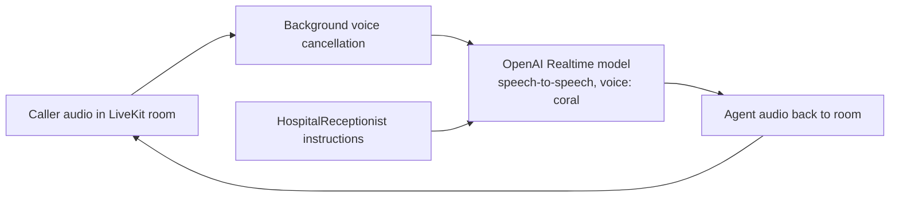

# voice-agent

A minimal real-time voice agent that acts as a hospital receptionist, built on LiveKit Agents (Node.js) and the OpenAI Realtime API.

## What it does

- Runs as a LiveKit Agents worker (`cli.runApp` + `WorkerOptions`) that joins a LiveKit room when a session is dispatched.
- Uses a single speech-to-speech model, `openai.realtime.RealtimeModel` with the `coral` voice, rather than separate STT, LLM and TTS stages.
- Applies background voice cancellation to the caller's audio (`BackgroundVoiceCancellation` from `@livekit/noise-cancellation-node`).
- Defines a `HospitalReceptionist` agent whose system instructions are: greet the patient, ask their name, ask which department they want, stay short and polite, and never give medical advice.
- Speaks first: on connect it calls `session.generateReply` to greet the patient and ask how it can help, then waits for that greeting to finish playing. After that, `voice.AgentSession` handles the back-and-forth turns.

## How it works



## Tech stack

- Node.js (ES modules)
- `@livekit/agents` ^1.0.43: agent worker, `voice.Agent`, `voice.AgentSession`
- `@livekit/agents-plugin-openai` ^1.0.43: OpenAI Realtime model
- `@livekit/noise-cancellation-node` ^0.1.9: background voice cancellation
- `dotenv` ^17.2.4: loads config from `.env.local`

## Run locally

Prerequisites: Node.js 18+, a LiveKit server or LiveKit Cloud project, and an OpenAI API key with Realtime access.

```bash
git clone https://github.com/yashsharma499/voice-agent.git
cd voice-agent
npm install
```

Create `.env.local` (it is gitignored). The code does not name these variables itself; they are the standard ones read by the LiveKit and OpenAI SDKs:

```
LIVEKIT_URL=
LIVEKIT_API_KEY=
LIVEKIT_API_SECRET=
OPENAI_API_KEY=
```

Start the worker:

```bash
npm run dev     # development mode
npm start       # production mode
```

The worker registers with your LiveKit server and waits for jobs. To talk to it, join a room from a LiveKit client (for example the LiveKit Agents Playground) connected to the same project.

## Next steps

- Capture the patient's name and department as structured data (for example via a function tool) instead of only conversing about them.
- Add tests; the code already skips starting the worker when `VITEST` is set, but no test files exist yet.
- Add a hand-off or escalation path, such as transferring to a human or routing to a department.
